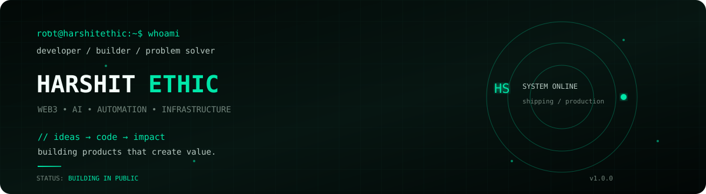

# Harshit Sharma

**Software engineer | AI developer tools · backend reliability · developer security · cross-platform software**

I build and maintain practical developer software with reproducible tests, explicit security boundaries and reviewable changes.

[Website](https://harshitethic.com) · [LinkedIn](https://www.linkedin.com/in/harshitethic/) · [Email](mailto:contact@harshitethic.com) · [Engineering notes](portfolio/engineering-case-studies.md)

## Featured original work

| Project | Why it matters | Try it / verification |
| --- | --- | --- |
| **[LeaseLedger](https://github.com/harshitethic/LeaseLedger)** · Python / SQLite | Durable, single-host job queue: fenced worker leases, crash recovery, retries and consistent backups. | [One-command recovery demo](https://github.com/harshitethic/LeaseLedger/blob/main/docs/reproducible-demo.md) · [CI](https://github.com/harshitethic/LeaseLedger/actions/workflows/ci.yml) |
| **[PatchPilot](https://github.com/harshitethic/PatchPilot)** · Python / FastAPI | Local-first AI coding workflow with bounded execution, fail-closed Docker test isolation and reviewable Git diffs. | [Preview release](https://github.com/harshitethic/PatchPilot/releases/tag/v0.4.0) · [Isolation CI](https://github.com/harshitethic/PatchPilot/actions/workflows/docker-isolation.yml) |
| **[ClonePeek](https://github.com/harshitethic/clonepeek)** · Python / GitHub Actions | Passive scanner for known editor, package, devcontainer and AI-agent execution hooks in unfamiliar repositories. | [Real CLI replay](https://harshitethic.github.io/clonepeek/#video-demo) · [GitHub Action](https://github.com/marketplace/actions/clonepeek-passive-repository-execution-audit) |
| **[RepoPilot](https://github.com/harshitethic/RepoPilot)** · FastAPI / React | Browse and search repository source locally, with optional Ollama Q&A and guarded ZIP/Git imports. | [Real browser walkthrough](https://github.com/harshitethic/RepoPilot/blob/main/docs/RepoPilot-live-verified-walkthrough.gif) · [First-run guide](https://github.com/harshitethic/RepoPilot/blob/main/docs/first-run.md) |

**Hands-on evidence:** [Three short engineering case studies](portfolio/field-notes.md) · [Full technical portfolio](portfolio/engineering-case-studies.md) · [Watch/try real demos](portfolio/demo-gallery.md)

## Accepted contributions to other projects

**138 PRs merged into repositories outside this account** as of 28 October 2026 (GitHub search). This is a count of accepted PRs, **not** a claim that every PR received independent human review or has equal technical significance. A few representative merged, traceable changes:

- **[ChurchCRM #10806](https://github.com/ChurchCRM/CRM/pull/10806)** — block unauthenticated browser access to nested dependency metadata across Apache, nginx and Caddy/FrankenPHP, with security regressions.
- **[Caura #2020](https://github.com/caura-ai/caura/pull/2020)** — add bounded, opt-in API retries while refusing to retry write operations that could duplicate side effects.
- **[Concord #1215](https://github.com/useconcord/concord/pull/1215)** — fix outgoing transfer-debit accounting and add regression tests.
- **[PyPA #2145](https://github.com/pypa/packaging.python.org/pull/2145)** — clarify Python C API versus ABI after maintainer-requested revisions and approval.
- **[ChurchCRM #10759](https://github.com/ChurchCRM/CRM/pull/10759)** — repair Slim application routing in FrankenPHP.
- **[agent-trace #264](https://github.com/Siddhant-K-code/agent-trace/pull/264)** — add a read-only Codex hook activation preflight.

[Accepted upstream PRs](https://github.com/search?q=author%3Aharshitethic+type%3Apr+is%3Amerged+-user%3Aharshitethic&type=pullrequests) · [Open upstream PRs](https://github.com/search?q=author%3Aharshitethic+type%3Apr+is%3Aopen+-user%3Aharshitethic&type=pullrequests). Open/draft changes are not described as accepted.

## Community-used projects

- **[chatgpt-bot-telegram](https://github.com/harshitethic/chatgpt-bot-telegram)** — maintained JavaScript/Telegram example, safer configuration and regression tests.
- **[ChatGPT-Telegram-Bot](https://github.com/harshitethic/ChatGPT-Telegram-Bot)** and **[whatsapp-chatgpt](https://github.com/harshitethic/whatsapp-chatgpt)** — popular *legacy* examples; the original API integrations are not presented as current production-ready software.
- **[FxSound Linux/macOS](https://github.com/harshitethic/fxsound-linux-macos)** — experimental native audio port with Linux/macOS build CI. **Alpha**, not a finished replacement.

**Clean checkout evidence:** [54 + 100 + 116 Python tests on Kali, commands and limitations](portfolio/verified-clean-checkouts-2026-10-23.md).

**Independent testers:** [Reproduce the flagship demos and report verified feedback](portfolio/independent-evaluation.md). The review checklist distinguishes real users from automated fixtures and lists security, benchmark and release boundaries.

## Working principles

**Reproduce → isolate the cause → write a regression → implement the fix → run CI → document limits → get review.**

Tooling: Python · TypeScript/JavaScript · C++ · SQLite · FastAPI · React · Linux/macOS · Docker · GitHub Actions.

Security claims are scoped to the demonstrated boundary. Tests, synthetic benchmarks and maintainer-run examples do **not** imply independent security certification or production adoption.

**Collaboration:** [Issues and discussions](https://github.com/harshitethic?tab=repositories) · [Technical writeups](portfolio/engineering-case-studies.md) · [contact@harshitethic.com](mailto:contact@harshitethic.com)

Want every architecture detail and source link? Read the [original extended profile](portfolio/profile-full-2026-10-23.md).
